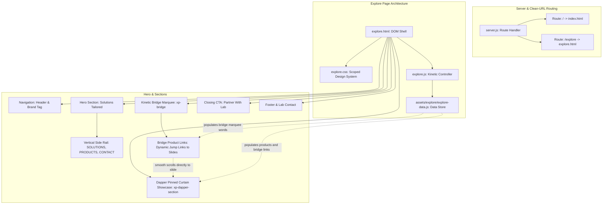

# GRAPHIFY.md — Architectural Knowledge Graph & Agent Rules for Explore Page

## 1. Overview & Graph Scope
This document provides the formal architectural knowledge graph, component dependency matrix, and operational rules for the **AI Labs by Nimbus Explore / Solutions** application surface (`/explore`).

---

## 2. Graph Nodes & Architectural Map

---

## 3. Node Details & Dependencies

| Node ID | Type | File Location | Responsibility |
| :--- | :--- | :--- | :--- |
| `SRV` | Server | `server.js` | Zero-dependency HTTP static server routing clean URL `/explore` to `explore.html`. |
| `EXP_HTML` | Document | `explore.html` | Semantic markup, preloader, hero, kinetic marquee bridge, monochromatic showcase grid, and footer. |
| `EXP_CSS` | Styling | `explore.css` | Scoped styling tokens (`--xp-*`), aurora canvas, kinetic bridge marquee, Clay-style monochromatic cards, Dapper HUD styling. |
| `EXP_JS` | Logic | `explore.js` | IIFE controller for particle atmosphere, Clay-style alternating card rendering, bridge smooth scroll trigger, and dynamic bridge jump links. |
| `EXP_DATA` | Data Model | `assets/explore/explore-data.js` | Global `window.NIMBUS_EXPLORE_DATA` containing `products[]` (with images and badges) and `services[]` models. |
| `BLNK` | Interaction | `explore.html` + `explore.js` | Dynamic kinetic bridge marquee links targeting each product in `#products`, alternating solid fill & stroke outline, smoothly scrolling to each pinned slide. |
| `SHW` | Component | `explore.html` + `explore.js` | Dapper Pinned Curtain Showcase (`.xp-dapper-section`, `.xp-dapper-sticky`, `.xp-dapper-layer`): 500vh pinned sequence with 5 rising color layers, Clay two-column layout, generous whitespace, sharp 0px edges, and dynamic contrast inversion. |

---

## 4. Mandatory Rules for Agents Modifying This Page

Any AI agent, developer, or automation touching the Explore / Solutions page **MUST** strictly adhere to the following rules:

### Rule 1: Content Separation (Strict Data-Driven Design)
- **NEVER hardcode product cards or service items in `explore.html`.**
- All catalogue items, product names, summaries, feature lists, statuses, and links **MUST** reside inside `assets/explore/explore-data.js`.
- The markup in `explore.html` acts solely as the structural template; `explore.js` dynamically renders data onto the UI.

### Rule 2: Kinetic Bridge & Marquee Interactivity
- The kinetic marquee bridge (`.xp-bridge`) renders interactive links dynamically for all products in `DATA.products`.
- Clicking any marquee link smoothly scrolls to the exact pinned position for that product slide in the 500vh stage.
- Alternates between solid white fill (`.is-fill`) and stroke outline (`-webkit-text-stroke`) without gradients.
- **NEVER apply `aria-hidden="true"` to containers that hold interactive links or buttons**, as this violates accessibility standards and blocks screen reader interaction.

### Rule 3: Visual & Typography Hierarchy
- **Header Line 1** (`.xp-hero__title-line1`): Single primary punch word (e.g. `SOLUTIONS`) styled with fluid typography `clamp()`.
- **Header Line 2** (`.xp-hero__title-line2`): Descriptive sub-phrase (e.g. `Tailored for Problem Solving`).
- **Eyebrow** (`.xp-eyebrow`): Value statement (e.g. `Fast, Precise, Reliable, to the Point`).
- **Side Rail** (`.xp-hero__rail`): Vertical tracking labels must stay in sync with page sections (`SOLUTIONS`, `PRODUCTS`, `SERVICES`, `CONTACT`).

### Rule 4: Zero-Dependency & Pure Vanilla JavaScript
- Browser code must run in an IIFE (`'use strict'`).
- Do not import external JS libraries or build tool outputs.
- No Node dependencies or bundler steps.

### Rule 5: Verification Checklist Before Claiming Done
1. **Syntax Check**: Run `node --check explore.js` and `node --check assets/explore/explore-data.js`.
2. **Server Route**: Ensure `node server.js` serves HTTP 200 on `/explore` and `/`.
3. **Responsive Visual Test**: Confirm no overlapping text between the hero content and the bottom scroll cue at desktop or mobile viewports.

### Rule 6: Dapper Sticky Curtain Architecture & 0px Sharp Edges
- **Pinned Curtain Sequence**: The products showcase runs inside a 500vh container (`.xp-dapper-section`) with a 100vh pinned viewport (`.xp-dapper-sticky`). Layers 2–5 wipe up from `translateY(100%)` to `0%` during scroll scrub via `requestAnimationFrame`.
- **Zero Border-Radius**: All media frames, buttons, tags, and containers in the product showcase MUST have `border-radius: 0 !important`. No rounded cards, pills, or boxes.
- **Clay-Style Whitespace**: Content is arranged in alternating two-column layouts inside a max-1400px centered shell with generous padding and vertical air above and below the content.
- **Dynamic Contrast Inversion**: Chapter 4 (`#fcf7f8` Cognition White) inverts text, features, and buttons to solid obsidian black (`#020016`). Chapters 1, 2, 3, and 5 use pure white typography.
